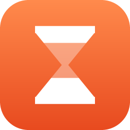
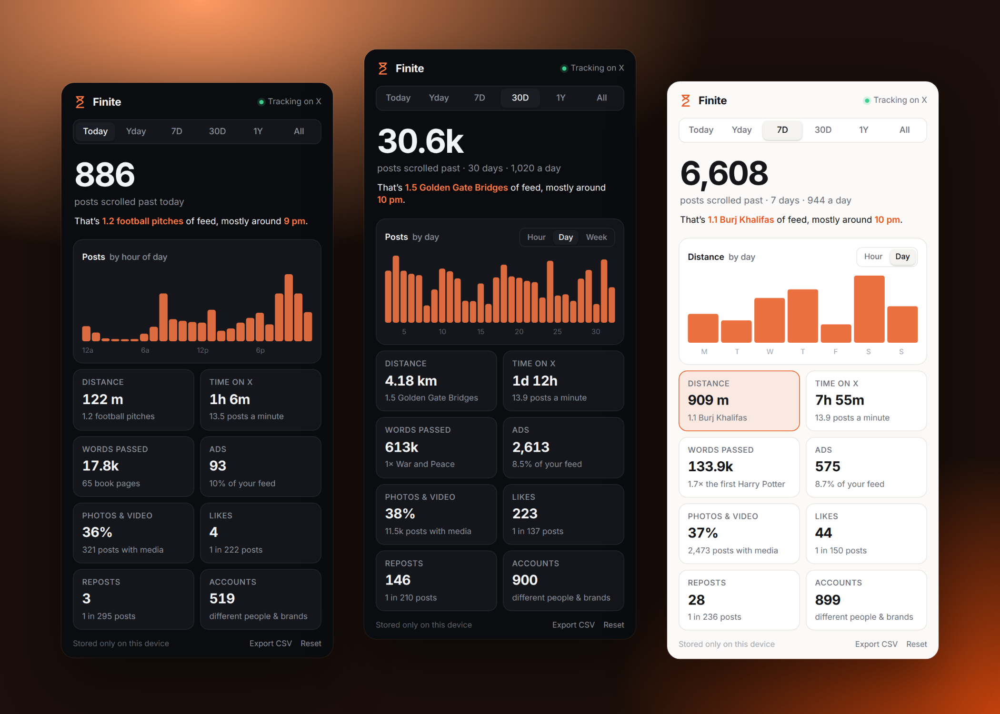

<div align="center">



# Finite

**The feed is infinite. Your time isn't.**

A lightweight scroll counter for X. Finite counts every post you scroll past, along with how far, how long and what it was made of, and turns the totals into numbers you can picture.

[](https://github.com/bx0-val/finite/actions/workflows/ci.yml)
[](https://github.com/bx0-val/finite/releases)
[](LICENSE)




</div>

## Why

Infinite scroll is built so there's never a natural place to stop. Finite doesn't block anything or nag you. It just keeps an honest count. You might find that **1,284 posts** is a lot for a Tuesday, or that you scrolled **2.4 Eiffel Towers** of feed before breakfast.

## What it measures

| Metric | What it means | Put into perspective as |
| --- | --- | --- |
| **Posts** | Each post that was at least half on screen, counted once per day | posts per day, your peak hour |
| **Distance** | How far the feed moved under your thumb or wheel | Statues of Liberty → Eiffel Towers → Burj Khalifas → marathons |
| **Time on X** | Time X was visible, focused and in use (idle time doesn't count) | posts per minute |
| **Words passed** | Words in the posts you scrolled past | book pages → *The Great Gatsby* → *War and Peace* |
| **Ads** | Promoted posts in your feed | share of your feed |
| **Photos & video** | Posts with media | share of your feed |
| **Likes & reposts** | Ones you gave | "1 like in every 143 posts" |
| **Accounts** | Different people and brands you saw | |

## The dashboard

Click the toolbar icon.

- **Ranges:** Today, Yesterday, 7 days, 30 days, Year, All time
- **Chunking:** hour of day, day, week or month. Click any metric card to chart it.
- **Export:** download every day as CSV
- **Themes:** follows your system's light or dark mode

## Privacy

Finite has **no servers, no analytics and no network requests**. Your stats are stored in your browser's extension storage and never leave your device. It reads posts only to count them: their ids (to avoid double counting), author handles (for the Accounts count) and word counts. Post text is never stored. See [PRIVACY.md](PRIVACY.md).

Permissions: `storage` and `unlimitedStorage` for your history, plus access to `x.com` / `twitter.com` to count. Nothing else.

## Install

Store listings are on the way. Until then:

**Chrome / Edge / Brave**
1. Download `finite-<version>-chrome.zip` from the [latest release](https://github.com/bx0-val/finite/releases) and unzip it.
2. Open `chrome://extensions`, turn on **Developer mode**, click **Load unpacked** and pick the unzipped folder.

**Firefox**
1. Download `finite-<version>-firefox.zip` from the [latest release](https://github.com/bx0-val/finite/releases).
2. Open `about:debugging#/runtime/this-firefox` → **Load Temporary Add-on…** → pick the zip. (Temporary add-ons are removed when Firefox restarts until the AMO listing is live.)

## How it works

```
x.com tab ─┐   content script                       background                  popup
x.com tab ─┼─► IntersectionObserver on posts ──►  single writer, de-dupes  ──►  reads storage,
           │   scroll / activity / like clicks    by post id per day,         renders ranges
           └── batched deltas every 5 s            stores per-day totals       and charts
```

- `entrypoints/content.ts`: watches posts and activity, batching updates every 5 seconds.
- `entrypoints/background.ts` + `lib/storage.ts`: merges updates from every tab through one queue, so tabs never overwrite each other.
- `lib/stats.ts`: per-day and per-hour data model, ranges and chunking.
- `lib/perspective.ts`: the comparisons and number formatting.
- `lib/detect.ts`: reads a post using X's `data-testid` attributes. If X changes its markup, this is the file to update.
- `entrypoints/popup/`: the dashboard. No framework, about 11 KB.

## Develop

Requires Node 20+.

```sh
npm install
npm run dev            # Chrome with the extension loaded and live reload
npm run dev:firefox    # Firefox
npm test               # unit tests (data model, perspective, post detection)
npm run compile        # type-check
npm run screenshot     # regenerate docs/ images from demo data (needs Chrome)
npm run zip && npm run zip:firefox   # store packages in .output/
```

Releases are automated: push a `v*` tag and [the release workflow](.github/workflows/release.yml) tests, builds and attaches the Chrome, Firefox and source zips.

## Contributing

Issues and pull requests are welcome. Ideas for new perspective comparisons are especially welcome. See [CONTRIBUTING.md](CONTRIBUTING.md).

## License

[MIT](LICENSE). Finite is an independent project and is not affiliated with X Corp.
